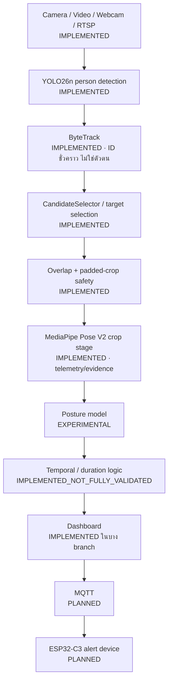

# ANYA / SitDee

ต้นแบบงานวิจัย **AI ติดตามท่านั่ง (posture monitoring)** แบบยืดหยุ่น ใช้แกน AI ชุดเดียวกันสำหรับ 2 โหมด
**ไม่ใช่ระบบวินิจฉัยทางการแพทย์** ใช้เพื่อ ergonomic feedback และงานวิจัยเท่านั้น

| โหมด | อินพุต | สถานะ |
|---|---|---|
| **PERSONAL MODE** | Webcam / USB → ผู้ใช้ 1 คน (เลือกเป้าหมายได้) | ใช้ได้ในการทดลองแบบมีผู้ควบคุม |
| **MULTI-PERSON MODE** | CCTV / RTSP → detection + tracking → ท่าทางรายคน | ระบบรันได้ แต่ **ยังไม่ได้ validate ความแม่นยำและความต่อเนื่องของตัวตน** |

## จุดประสงค์การใช้งาน
- ใช้ติดตามท่านั่งและให้ feedback เชิงพฤติกรรม เช่น นั่งตรง / เอนหน้า / เอนหลัง / เอียงซ้าย / เอียงขวา / UNKNOWN
- **ไม่ได้** วินิจฉัย รักษา หรือป้องกันโรค (รวมถึง Office Syndrome)

## สถาปัตยกรรม


- **POSE_OK** หมายถึง "ได้ pose มา" เท่านั้น ไม่ได้แปลว่าท่าทางที่จำแนกถูกต้อง
- **Confidence ของโมเดล ≠ ความแม่นยำ**

## ความสามารถปัจจุบัน (สรุป — รายละเอียดใน [PROJECT_STATUS.md](PROJECT_STATUS.md))
- **อินพุต:** ไฟล์วิดีโอ / USB webcam / RTSP (Hikvision profiles) ผ่าน `src/posture_ai/inference/video_source.py`
- **ตรวจจับและติดตามคน:** YOLO + ByteTrack แบบหลายคน, เลือกเป้าหมายด้วยการคลิก, และตรวจว่า crop ไม่ปนกับคนอื่น
- **โมเดลท่าทาง:**
  - **V4** (frozen): 2 class TUP/TLB
  - **Webcam P001 five-class exp v1** (ทดลอง): 5 class + UNKNOWN ฝึกจากคนเดียว
- **Human Ground Truth collector:** เก็บป้ายจากคนสำหรับ webcam และแยก Human GT ออกจาก AI prediction
- **Long-session runner:** บันทึก telemetry แบบจำกัดขนาด โดยปิดการบันทึกวิดีโอดิบเป็นค่าเริ่มต้น

## ข้อจำกัดสำคัญ
- **การ generalize:** โมเดล 5 ท่าฝึกจาก **คนเดียว (P001)** เมื่อทดสอบกับคนใหม่ใน MultiPosture macro-F1 ตกเหลือราว 0.54
- **CCTV:** มี Human Ground Truth ที่ยอมรับแล้ว = **0 แถว**
- **ตัวตนในโหมดหลายคน:** ยังไม่ได้วัด ID switch และ track ID ไม่ใช่ตัวตนของคน
- **Raspberry Pi:** ยังไม่ได้ทดสอบ ผลบน PC ใช้แทนผลบน Pi ไม่ได้
- **รันยาว:** ข้อมูลที่มีคือรัน 3 ชม. 51 นาที, 1 ชม. และ 10 นาที ยังไม่พิสูจน์การรันต่อเนื่องหลายวัน

## Quick start (Windows, PowerShell)
```powershell
Set-Location 'C:\Users\ADMIN\Documents\ChatGPT\AnyaTrainModel\office-posture-datasets'
git status; git branch --show-current; git log -5 --oneline
```
**สภาพแวดล้อม Python** (ดู `reports/environment.md`)
- `.venv` — Python 3.12: numpy, pandas, scikit-learn, OpenCV, MediaPipe, pytest ใช้กับเกือบทุกอย่างและกับ test
- `.venv_yolo` — Python 3.12 + PyTorch (CUDA) + Ultralytics สำหรับ YOLO/ByteTrack; ตัวรันหลายตัว (เช่น `run_upper_body_posture_v2.py`) รันด้วย `.venv` และเพิ่ม `.venv_yolo/Lib/site-packages` เข้า `sys.path` เอง
- เครื่อง laptop ที่สเปกต่ำ: `setup_laptop_dev.ps1` แล้วตามด้วย `start_laptop_dev.bat` (ใช้ `requirements-laptop.txt`)

**Test แบบปลอดภัย** (ไม่เปิดกล้อง ไม่ฝึกโมเดล)
```powershell
.\.venv\Scripts\python.exe -m pytest -q tests\test_pose_v2_stage.py tests\test_autonomous_long_session.py tests\test_yolo_tracking_adapter.py tests\test_anya_live_demo_fiveclass.py tests\test_webcam_human_gt_v1.py tests\test_video_source.py
```

**Webcam (PERSONAL MODE, ทดลอง)**
```powershell
.\.venv\Scripts\python.exe scripts\run_upper_body_posture_v2.py --source webcam --camera-index 0 --posture-model webcam-p001-fiveclass-exp-v1
```
หรือใช้ `run_webcam_demo.bat` สำหรับ prototype รุ่นเก่า

**RTSP (MULTI-PERSON MODE, ทดลอง):** ห้ามใส่ URL ที่มีรหัสผ่านใน command หรือไฟล์ที่ commit
1. `Copy-Item .env.example .env` แล้วใส่ค่าจริงใน `.env` ภายในเครื่องเท่านั้น (ไฟล์นี้ git ignore อยู่แล้ว)
2. ตรวจกล้อง: `.\.venv\Scripts\python.exe scripts\check_rtsp_source.py --source rtsp --profile HIKVISION_MAIN --frames 30 --seconds 10`
3. รัน: `.\.venv\Scripts\python.exe scripts\run_multiperson_demo.py --source rtsp --profile HIKVISION_MAIN --max-people 3 --tracking-mode generic --no-display`

คำสั่งอื่น ๆ ทั้งหมด (training, V4 inference, RTSP AI lab, collectors) อยู่ใน [reports/README_TECHNICAL_EN.md](reports/README_TECHNICAL_EN.md)

## โครงสร้าง repository
| โฟลเดอร์ | เนื้อหา |
|---|---|
| `src/posture_ai/` | แกน AI: `inference/` (video source, Pose V2, ตัวรันโมเดล), `detection/` (YOLO/ByteTrack), `multiperson/`, `monitoring/` (long session), `features/`, `data/`, `evaluation/`, `ergonomics/` |
| `scripts/` | ตัวรัน, collectors, benchmarks, audits |
| `tests/` | unit และ offline integration tests (ไม่เปิดกล้อง) |
| `configs/` | RTSP profiles, taxonomy, seat layout ตัวอย่าง |
| `metadata/`, `data/dataset_registry_v2.json` | manifest และ hash ของ dataset |
| `reports/` | รายงานการทดลองและ audit |
| `outputs/models/` | ใน Git มีเฉพาะโมเดลเล็กที่อนุญาต (V4, upper-body candidates) ส่วน output อื่นไม่อยู่ใน Git |
| `datasets/`, `validation_data/` | **ไม่อยู่ใน Git** ดูวิธีกู้คืนใน [DATASETS.md](DATASETS.md) |

## ความเป็นส่วนตัว
- ประมวลผลในเครื่อง (local) เป็นหลัก และ**ไม่ใช้ face recognition**
- ปิดการบันทึกวิดีโอหรือภาพดิบเป็นค่าเริ่มต้นใน long-session / collectors (ยกเว้น dashboard ที่บันทึกโดยตั้งใจเมื่อมีความยินยอม)
- ข้อมูลฝึกต้องเก็บโดยตั้งใจ และมีความยินยอมที่บันทึกไว้
- Human GT ต้องแยกจาก AI prediction เสมอ

## Roboflow Pose (optional, experimental)

เครื่องมือเตรียมข้อมูล Keypoint Detection อยู่ใน `reports/roboflow_integration_th.md` ใช้เก็บภาพแบบมี consent, ตรวจ participant leakage ใน train/valid/test และแปลงผล keypoints 2D กลับเป็นชื่อ landmark มาตรฐาน ห้ามส่ง keypoints 2D เข้าโมเดล V4/V2 เดิมซึ่งฝึกจาก MediaPipe world coordinates

## เอกสาร
- [PROJECT_STATUS.md](PROJECT_STATUS.md) — สถานะปัจจุบัน
- [CONTINUATION.md](CONTINUATION.md) — **เริ่มอ่านที่นี่ถ้าจะพัฒนาต่อ**
- [DATASETS.md](DATASETS.md) — dataset และวิธีกู้คืน
- [SECURITY.md](SECURITY.md) — ความปลอดภัยและความเป็นส่วนตัว
- [PROJECT_HANDOFF.md](PROJECT_HANDOFF.md) — การแบ่งบทบาทเดิม (ข้อมูลเก่า)
