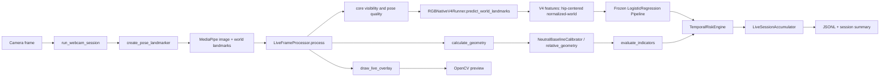
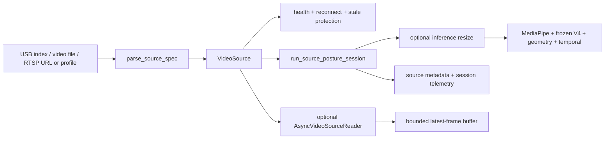

# Current system architecture

Audit date: 2026-09-07. This map describes the implemented project; it is
not a proposal to retrain or replace V1/V2/V4.

## Live path



Plain-text form: `Webcam frame → MediaPipe → image/world PoseLandmarks →
five-core gate → V4 features → frozen V4 classifier → geometry/neutral-relative
indicators → one temporal risk state → telemetry/summary/UI`.

## Responsibility map

| Stage | Implemented location | Responsibility |
|---|---|---|
| CLI and explicit camera start | `scripts/run_webcam_demo.py:main` | Parses camera, validation, calibration, preset, and frame-limit options. |
| Camera acquisition | `src/posture_ai/inference/webcam_v1.py:run_webcam_session` and `_windows_camera_capture` | Opens only the explicitly requested camera; reads/display frames; releases resources. |
| Performance presets | `resolve_performance_preset` | `DESKTOP`, `BALANCED`, and `LOW_SPEC` settings. |
| Frame skipping | `should_process_frame` and `run_webcam_session` | Displays every captured frame, runs inference at the selected interval, marks skipped records, and keeps real timestamps. |
| MediaPipe setup | `src/posture_ai/inference/pipeline.py:create_pose_landmarker` | MediaPipe Tasks Pose Landmarker, video mode, `num_poses=1`. |
| MediaPipe conversion | `extract_pose_result` and `PoseLandmarks.from_any` | Converts BGR to RGB and keeps canonical 33-point ordering. |
| Core input gate | `framing_assessment`, `core_visibility_summary`, and `evaluate_visibility_policy` | Checks nose, both shoulders, and both hips at the configured visibility threshold. |
| Pose quality | `pose_quality_score` | Descriptive visibility/coverage value; not a health score. |
| V4 adapter | `src/posture_ai/inference/rgb_native_v4.py:RGBNativeV4Runner` and `src/posture_ai/features/rgb_native_v4.py` | Builds the exact 15-feature normalized-world schema and rejects mismatch. |
| V4 classifier | `outputs/models/rgb_native_v4/model.joblib` | Frozen two-class pipeline: `TUP` and `TLB`. |
| Geometry | `src/posture_ai/ergonomics/geometry.py:calculate_geometry` | Calculates camera-relative trunk/head/shoulder geometry. |
| Neutral calibration | `src/posture_ai/ergonomics/calibration.py:NeutralBaselineCalibrator` and `relative_geometry` | Collects a runtime-only neutral reference and derives relative geometry. |
| Geometry indicators | `src/posture_ai/ergonomics/indicators.py` | Separate experimental Forward/Left/Right indicators, not V4 classes. |
| Temporal state | `src/posture_ai/ergonomics/risk_engine.py:TemporalRiskEngine` | Maintains one probability history, stable direction, duration, and cooldown. |
| Session accumulation | `LiveSessionAccumulator` | Computes descriptive duration/percentage summaries; skipped frames are not fresh evidence. |
| Telemetry | `write_live_outputs` | Writes JSONL events and a JSON summary under `outputs/live/`. |
| UI | `draw_live_overlay` | Separates AI posture, confidence, input visibility, geometry, risk, and instructions. |

## Unified source path for future RTSP deployment

The conservative RTSP preparation adds a separate source-agnostic entry point
without changing the frozen webcam validation path:



Responsibilities:

| Stage | Implemented location | Responsibility |
|---|---|---|
| Source parsing | `src/posture_ai/inference/video_source.py:parse_source_spec` | Resolves USB, file, direct RTSP, and secret-free Hikvision profiles. |
| Source I/O | `VideoSource` | Opens/reads/closes explicitly requested input; no listener or network setup. |
| Source health | `SourceHealth` | Tracks connection, decode failures, FPS, resolution, age, reconnects, and backend limits. |
| Reconnect | `VideoSource.read` | Uses capped retry/backoff for non-file sources; failures remain source states, not posture states. |
| Async option | `AsyncVideoSourceReader` and `LatestFrameBuffer` | Keeps one latest frame and bounds memory; stale frames are marked separately. |
| RTSP runtime | `src/posture_ai/inference/stream_runtime.py:run_source_posture_session` | Runs the unchanged V4/geometry/temporal path on the unified source. |
| Safe diagnostic | `scripts/check_rtsp_source.py` | Limited health smoke test without AI, recording, screenshots, or server. |

The established `run_webcam_session` path remains available for the existing
single-person live validation. The new source runtime is the prepared path for
future file/RTSP deployment; it has not been run against a physical camera in
this preparation.

## Integrated optional multi-person path

```text
VideoSource
  → FRAME + source health
  → MultiPersonMediaPipeBackend(num_poses=max_people)
  → AnonymousPoseTracker
  → generic MultiPersonRuntime OR seat SeatAwareRuntime
  → Desktop frozen V4 + geometry + per-person/per-seat temporal state
  → source-safe telemetry → dashboard
```

`max_people` is bounded to 1–4. Seat mode requires an explicit approved YAML
layout; the example layouts are test fixtures only. Acer's original direct
`cv2.VideoCapture` path was not imported into production, so RTSP ownership
remains in `VideoSource`.

## Offline path

`src/posture_ai/inference/pipeline.py:infer_source` supports image files,
image directories, and prerecorded video. `scripts/infer_rgb_native_v4.py` and
the offline pipeline use the same MediaPipe world-landmark/V4 contract where
requested. Webcam source `0` is not part of the overnight preparation.

## Model and scientific boundaries

- V4 remains a frozen two-class pilot: `TUP = Upright`, `TLB = Lean Backward`.
- Forward/Left/Right are geometry indicators only.
- Geometry and risk messages are engineering diagnostics, not medical diagnosis
  or health scores.
- Current live processing has one pose slot and one temporal state.
- No new training, model export, raw-data conversion, webcam run, or room
  measurement was performed in this preparation.
